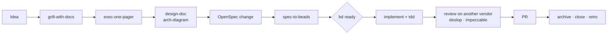

<p align="center">
  
</p>

<p align="center">
  
</p>

<p align="center">
  <a href="https://github.com/edwinjosechittilappilly/slipway/actions/workflows/ci.yml"></a>
  
  
  
  <a href="LICENSE"></a>
</p>

# Slipway

**Your agentic development environment as code.** One command installs, and keeps current, the skills, coding
agents, model routing, task tracker and spec tooling you work with, across omp, Claude Code, Codex, Gemini and Cursor.

[ShipShape](https://github.com/edwinjosechittilappilly/shipshape-stack) makes a repository agent-ready. Slipway makes
your machine agent-ready.

## 60-second start

```bash
# 1. Preview: changes nothing, lists every component and command
curl -fsSL https://raw.githubusercontent.com/edwinjosechittilappilly/slipway/main/install.sh | bash -s -- --dry-run

# 2. Install (omp first; or add `--profile claude-code` / `--profile codex` if that is your harness)
curl -fsSL https://raw.githubusercontent.com/edwinjosechittilappilly/slipway/main/install.sh | bash
```

While the repo is private, swap the `curl` URL for your `gh` login:
`gh api repos/edwinjosechittilappilly/slipway/contents/install.sh -H "Accept: application/vnd.github.raw" | bash`.

The script installs Homebrew, git, gh, Node and uv if missing (and adds Homebrew to your shell profile), clones
Slipway to `~/.slipway`, installs the `slipway` CLI and runs `slipway install`. It asks for input only for the
Homebrew password; harness logins are listed at the end. Open a new terminal, then:

```bash
slipway doctor                      # what is installed, outdated, drifted, or needs a login
slipway profile new me              # capture your current omp routing as your own profile
cd ~/code/my-app && slipway init    # Beads + OpenSpec + agent docs for this repo
slipway ui                          # the Beads board in your browser
```

## What you get

| Pack | Installs | Why |
|---|---|---|
| `core` | git, gh, Node, uv, jq | Everything else stands on these |
| `harnesses` | **omp** (primary), Claude Code, Codex | Three vendors: route each job to the model that is best at it, review with a different one |
| `engineering` | [Matt Pocock's skills](https://github.com/mattpocock/skills): `grill-with-docs`, `to-spec`, `to-tickets`, `tdd`, `diagnosing-bugs`, `code-review`, `handoff`, … (26) | Grill before you build, slice into vertical tickets, test first |
| `quality` | [humanizer](https://github.com/blader/humanizer) (prose), [deslop](https://github.com/cursor/plugins) (code), [impeccable](https://github.com/pbakaus/impeccable) (UI) | Catch AI slop in what you write, ship and show |
| `tasks` | [Beads](https://github.com/gastownhall/beads) (`bd`) + [beads-ui](https://github.com/mantoni/beads-ui) | A dependency graph agents claim work from; a board you can watch |
| `spec` | [OpenSpec](https://github.com/Fission-AI/OpenSpec) | Agree on behaviour before code; native `oh-my-pi`, Claude and Codex support |
| `docs` | draw.io, pandoc, [drawio-skill](https://github.com/Agents365-ai/drawio-skill) | Diagrams and Word/PDF exports for the people who read your docs |
| `routing` | Slipway's own skills, global working rules, role agents, omp model roles | The glue: one flow, one set of rules, the right model per job |
| opt-in | `shipshape`, `jev`, `jev-router`, `office`, `security`, `harnesses-extra`, `parallel`, `factory` | `slipway packs` lists them; [skills catalogue](docs/skills.md) explains each |

Slipway's own skills:

| Skill | Use it to |
|---|---|
| `ship-flow` | Know the next step: idea → one-pager → design → spec → beads → build → review → PR → close |
| `exec-one-pager` | Get a decision: the ask, quantified problem, options with "do nothing", cost, risks, on one page |
| `design-doc` | Explain how and why to engineers: Google-style doc with arc42 checks and ADR links |
| `arch-diagram` | Generate IBM Design Language, C4 or your-brand diagrams as `.drawio` + `.svg` from a JSON spec |
| `spec-to-beads` | Turn an approved OpenSpec change into a Beads epic with tickets, dependencies and role labels |

## The delivery flow



Ask your agent "what's next?" and `ship-flow` reads the repo (one-pagers, `openspec/changes/`, `bd ready`, the branch)
to tell you which stage you are in and which skill runs it.

`slipway ui` opens the Beads board for the repo, so you can see what every agent has claimed, what is ready and what
is blocked:

<p align="center"></p>

## Route each job to the right harness and model

```text
$ slipway roles
  role       harness  model    resolves to                              ready
  explore    omp      @scout   google-antigravity/gemini-3.8-flash:low  yes
  plan       omp      @plan    openai-codex/gpt-6.1-sol:high            yes
  implement  omp      @task    openai-codex/gpt-6.1-terra:auto          yes
  review     omp      @review  anthropic/claude-opus-5-5:high           yes
  docs       omp      @draft   anthropic/claude-sonnet-5-5:medium       yes
  design     claude   opus                                              yes
```

- **Inside omp**, roles are omp model roles and task agents (`planner`, `issue-writer`, `pr-author`, `drafter`, plus the
  bundled `scout`, `task`, `reviewer`), so subagents route themselves. Switch whole setups with
  `/modelpreset switch frugal|daily|deep`.
- **Across harnesses**, `slipway run review "check this branch"` launches the mapped harness and model;
  `slipway run implement --harness codex` sends the same role to another vendor.
- **From the board**, label a bead `role:review` and run `slipway run --bead <id>`: Slipway claims it atomically and
  hands it, with its acceptance criteria, to the right harness.
- **In parallel**, `slipway install --packs parallel` adds Agent Deck; `--packs factory` adds Gas City, which runs
  formulas over the same Beads graph. See [docs/harnesses.md](docs/harnesses.md).

## Stay current without surprises

Skills are prompts that run with your permissions, so Slipway treats them like dependencies:

- `slipway.lock.json` pins every skill source to a commit and every npm tool to a version.
- A weekly workflow runs `slipway lock --refresh` and opens a PR listing the changed `SKILL.md` files with compare
  links. You review it like any dependency bump.
- `slipway update` pulls this repo and moves your machine to the lock. `--latest` skips the lock; `--prune` removes
  skills Slipway installed that you dropped from the manifest. Older copies that upstream renamed (for example
  `to-prd` → `to-spec`) are listed by `doctor` with the exact remove command; Slipway never deletes them itself.
- Your edits win. Slipway remembers what it wrote; if you changed a model role, a managed block or a skill, it keeps
  your version and `doctor` reports the drift. `--force` overrides.

## Make it yours

The base manifest is provider-neutral. Your choices live in a profile under `~/.config/slipway/profiles/`, outside the
checkout, so `slipway update` never conflicts with them:

```bash
slipway profile new me                       # captures the omp model roles and presets you use today
slipway profile new me --copy claude-code    # or start from a shipped profile: edwin, claude-code, codex
slipway install --dry-run                    # see what changes; your profile is already selected
```

A profile can enable packs (`enable_packs = ["security"]`), switch off single components
(`[[component]] id = "codex"` + `enabled = false`), and point roles at other harnesses. Details:
[docs/configuration.md](docs/configuration.md).

## Commands

| Command | What it does |
|---|---|
| `slipway install [--profile p] [--packs a,b] [--dry-run]` | Install everything in the selected packs; safe to re-run |
| `slipway update [--latest] [--prune]` | `git pull`, move components to the lock, refresh the blocks in repos you `init`-ed |
| `slipway doctor [--json \| --markdown]` | Status, drift, missing logins; `--markdown` is a shareable summary |
| `slipway profile new <name> [--copy p]` | Create your own profile from your current setup |
| `slipway packs` | Packs and what each one installs |
| `slipway init [path] [--stealth]` | Set up a repo: Beads, OpenSpec, `docs/agents/*`, AGENTS.md block |
| `slipway roles` / `slipway run <role> [prompt]` / `slipway run --bead <id>` | See and use the role → harness → model map |
| `slipway ui [path]` | Open the Beads board |
| `slipway lock [--refresh]` | Show pins, or resolve upstream and report changes |
| `slipway uninstall` | Remove the links, blocks and omp entries Slipway wrote |

## FAQ

**Will it overwrite my config?** No. Before each run it snapshots your agent config files to
`~/.local/state/slipway/backups/`. It merges omp settings with the 3-way rule, keeps values you changed, never
replaces a skill installed from another source, and moves anything `--force` replaces into the backup folder.

**I only use Claude Code (or Codex).** `slipway install --profile claude-code` (or `codex`). Those profiles switch off
omp and point every role at your harness. Skills land in `~/.agents/skills` (Codex reads it) and are linked into
`~/.claude/skills`; the working rules go into `~/.claude/CLAUDE.md` and `~/.codex/AGENTS.md`.

**Why Beads and not GitHub Issues?** Agents need a dependency graph and atomic claims they can query in
milliseconds. GitHub stays the public record; `bd github push` mirrors what matters. Backlog.md is the documented
lighter alternative. See [ADR 0002](docs/adr/0002-beads-for-agent-work.md).

**Why not chezmoi or rulesync?** They move files. Slipway also pins skill commits, merges omp settings key by key,
and sets up repos. See [docs/comparison.md](docs/comparison.md).

**Does it phone home?** Slipway sends nothing. It sets `DISABLE_TELEMETRY=1` and `DO_NOT_TRACK=1` for every `npx`
call, and `slipway init` runs `bd metrics off` (Beads shares anonymous command counts by default; set
`beads_metrics = true` under `[project]` to keep them on).

## Docs

[Executive one-pager](docs/one-pager.md) · [Design doc](docs/design.md) · [Decisions](docs/adr/) ·
[Skills catalogue](docs/skills.md) · [Harnesses and routing](docs/harnesses.md) ·
[Configuration](docs/configuration.md) · [Comparison](docs/comparison.md) · [Contributing](CONTRIBUTING.md)

Licensed under [Apache-2.0](LICENSE). Upstream skills keep their own licences.
