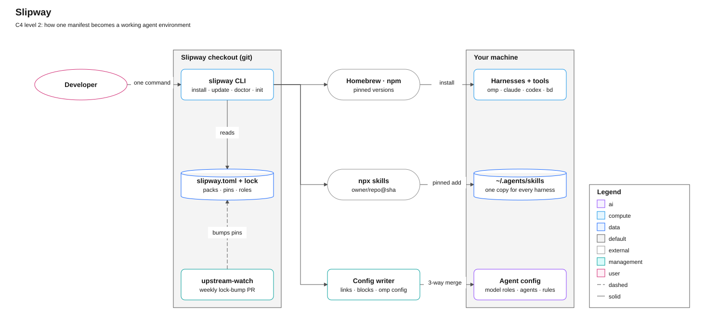
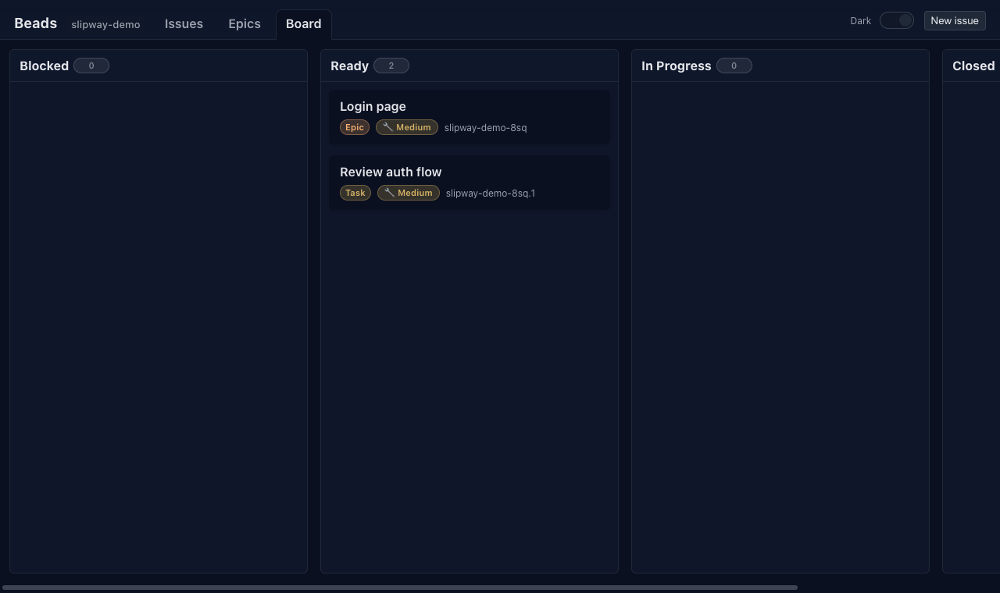

<p align="center">
  
</p>

<p align="center">
  <a href="https://github.com/edwinjosechittilappilly/slipway/actions/workflows/ci.yml"></a>
  
  
  
  <a href="LICENSE"></a>
</p>

# Slipway

**Dotfiles for AI coding agents.** Slipway sets up your machine for working with coding agents (omp, Claude Code,
Codex) and keeps that setup current. One command installs the agents, the skills they use, the model each kind of job
should run on, a task board agents can claim work from, and a spec tool. Then it gives every agent the same way of
working: idea → one-pager → design → spec → tickets → code → review → pull request.

## Is this for you?

Yes, if you:

- use one or more coding agents every day and have collected skills, plugins and config by hand;
- want the same rules and skills in every agent, not a different setup per tool;
- want each job (exploring, planning, coding, reviewing, writing) to use the model that is best at it;
- want skill updates you can review, not ones that change under you.

It is not an application template (that is [ShipShape](https://github.com/edwinjosechittilappilly/shipshape-stack),
which makes a *repository* agent-ready), and it does not run agents for you in the background. You still drive the
agent; Slipway makes sure it has the right tools and habits.

## What changes on your machine

| Before | After `slipway install` |
|---|---|
| Skills copied by hand from READMEs; renamed ones keep loading | 30+ skills pinned to a commit, one copy shared by every agent |
| Each agent has its own rules, or none | One set of working rules in omp, Claude Code, Codex and Gemini |
| Every job runs on whatever model is active | Exploring, planning, coding and reviewing each go to a chosen model |
| Tasks live in chat history and TODO comments | A Beads task graph agents claim work from, and a board you can watch |
| "Let's just start coding" | A one-pager, a design doc with diagrams, and an OpenSpec change before code |
| Updates happen whenever a tool updates itself | A weekly pull request shows exactly which skill files changed |

Everything Slipway writes is recorded, your own edits are never overwritten, and `slipway uninstall` removes it.

<p align="center">
  
</p>

## Install

```bash
# 1. Preview: changes nothing, lists every component and command
curl -fsSL https://raw.githubusercontent.com/edwinjosechittilappilly/slipway/main/install.sh | bash -s -- --dry-run

# 2. Install (omp setup by default; add `--profile claude-code` or `--profile codex` if that is your agent)
curl -fsSL https://raw.githubusercontent.com/edwinjosechittilappilly/slipway/main/install.sh | bash
```

While the repo is private, use your `gh` login instead of `curl`:
`gh api repos/edwinjosechittilappilly/slipway/contents/install.sh -H "Accept: application/vnd.github.raw" | bash`.

The script installs Homebrew, git, gh, Node and uv if they are missing, clones Slipway to `~/.slipway`, installs the
`slipway` command and runs `slipway install`. It asks only for your Homebrew password and lists the agent logins you
still need at the end. Open a new terminal afterwards and run `slipway doctor` to check everything.

## How you use it

You use Slipway in two places:

1. **In your terminal**, the `slipway` command sets things up and keeps them current.
2. **Inside your agent** (omp, Claude Code, Codex), you work. The skills Slipway installed are already there.

| Where | You type | When |
|---|---|---|
| Terminal | `slipway doctor` | Something looks off, or you want to know what is outdated |
| Terminal | `slipway update` | About once a week |
| Terminal, in a repo | `slipway init` | Once per repo, before the first agent session there |
| Terminal, in a repo | `slipway ui` | You want to see the task board |
| Inside omp | Ask "what's next?", or type `/skill:ship-flow` | Every working session |
| Inside Claude Code / Codex | Ask, or type `/ship-flow` / `$ship-flow` | Same, if you work there |

You rarely need to name a skill. Each one is installed with a description, so the agent uses it when your request
matches: "write a one-pager for X", "draw the architecture", "turn this spec into tickets".

A typical day:

```bash
cd ~/code/my-app
slipway init          # first time in this repo only
omp                   # start your agent, then talk to it:
```

```text
> I want to add SSO login. What's next?               ← ship-flow sizes the work and picks the first stage
> Write the one-pager for it.                          ← exec-one-pager
> Approved. Design doc with a C4 container diagram.    ← design-doc + arch-diagram
> Propose it as an OpenSpec change, then make beads.   ← openspec-propose + spec-to-beads
> Work the next ready bead.                            ← bd ready, claim, tdd, review, pr
```

In a second terminal, `slipway ui` shows the beads moving from Ready to Closed:

<p align="center"></p>

## Ship flow: the "what's next?" skill

`ship-flow` is the skill that ties everything together. It holds the delivery process, works out which stage you are
in by looking at the repo, and tells the agent which skill to run and what has to be true before moving on.

It sizes the work first, so small changes skip the paperwork:

| Size | Looks like | Stages |
|---|---|---|
| Tiny | Under an hour, one area, nothing public changes | Build → review → ship |
| Small | One session, behaviour is clear | Quick grill → one bead → build → review → ship |
| Feature | Several sessions, or behaviour others depend on | All nine stages |
| Initiative | Needs budget or buy-in | One-pager first, then `wayfinder` to map it, then each feature |

The stages:

| # | Stage | Skill / tool | Done when |
|---|---|---|---|
| 1 | Clarify | `grill-with-docs` | Goal and acceptance check fit in one line each |
| 2 | Decide | `exec-one-pager` | The decision owner said yes |
| 3 | Design | `design-doc` + `arch-diagram` | Reviewed by a different vendor's model |
| 4 | Spec | `openspec-propose` | `openspec validate` passes and you approve |
| 5 | Tickets | `spec-to-beads` | No dependency cycles; every bead has an acceptance check |
| 6 | Build | `bd ready` → `implement` + `tdd` | The ticket's acceptance check passes |
| 7 | Review | `code-review`, `deslop`, `impeccable` for UI | No blockers left |
| 8 | Ship | `pr` skill → `gh pr create` | CI green |
| 9 | Close | `openspec-archive-change`, `bd close`, `retro` | Specs match what shipped |

How it knows where you are: no one-pager yet → stage 2; one-pager but no design doc → 3; design but no OpenSpec change
→ 4; change but no beads → 5; `bd ready` returns work → 6; a branch without a PR → 7 and 8.

## What gets installed

| Pack | Installs | Why |
|---|---|---|
| `core` | git, gh, Node, uv, jq | Everything else stands on these |
| `harnesses` | **omp**, Claude Code, Codex | Three vendors: each job on the model best at it, review on a different one |
| `engineering` | [Matt Pocock's skills](https://github.com/mattpocock/skills) (26): `grill-with-docs`, `to-spec`, `to-tickets`, `tdd`, `diagnosing-bugs`, `code-review`, `handoff`, … | Question the idea, slice vertical tickets, test first |
| `quality` | [humanizer](https://github.com/blader/humanizer) for prose, [deslop](https://github.com/cursor/plugins) for code, [impeccable](https://github.com/pbakaus/impeccable) for UI | Catch AI slop in what you write, ship and show |
| `tasks` | [Beads](https://github.com/gastownhall/beads) (`bd`) + [beads-ui](https://github.com/mantoni/beads-ui) | A dependency graph agents claim work from; a board you can watch |
| `spec` | [OpenSpec](https://github.com/Fission-AI/OpenSpec) | Agree on behaviour before code |
| `docs` | draw.io, pandoc, [drawio-skill](https://github.com/Agents365-ai/drawio-skill) | Diagrams, Word and PDF exports |
| `routing` | Slipway's own skills, shared working rules, role agents, omp model roles | One flow, one rule set, the right model per job |
| opt-in | `shipshape`, `jev`, `jev-router`, `office`, `security`, `harnesses-extra`, `parallel`, `factory` | `slipway packs` lists them |

Slipway's own skills:

| Skill | Use it to |
|---|---|
| `ship-flow` | Know the next step and which skill runs it |
| `exec-one-pager` | Get a decision: the ask, the problem in numbers, options including "do nothing", cost and risks on one page |
| `design-doc` | Explain how and why to engineers: Google-style doc with arc42 checks and ADR links |
| `arch-diagram` | Generate IBM-style, C4 or your-brand diagrams as editable `.drawio` and `.svg` |
| `spec-to-beads` | Turn an approved OpenSpec change into a Beads epic with tickets, dependencies and role labels |

## The right model for each job

```text
$ slipway roles
  role       harness  model    resolves to
  explore    omp      @scout   google-antigravity/gemini-3.8-flash:low
  plan       omp      @plan    openai-codex/gpt-6.1-sol:high
  implement  omp      @task    openai-codex/gpt-6.1-terra:auto
  review     omp      @review  anthropic/claude-opus-5-5:high
  docs       omp      @draft   anthropic/claude-sonnet-5-5:medium
  design     claude   opus
```

- **Inside omp** this happens on its own: omp's subagents (`scout`, `planner`, `task`, `reviewer`, `pr-author`,
  `drafter`) each use their role's model. Switch whole setups with `/modelpreset switch frugal|daily|deep`.
- **From the terminal**, `slipway run review "check this branch"` opens the mapped agent and model;
  `--harness codex` sends the same job to another vendor.
- **From the board**, label a bead `role:review` and run `slipway run --bead <id>`: Slipway claims it and hands it,
  with its acceptance criteria, to the right agent.
- **In parallel**, `--packs parallel` adds Agent Deck and `--packs factory` adds Gas City, which run several agents
  over the same Beads graph.

## Updates you can review

Skills are prompts that run with your agent's permissions, so Slipway treats them like dependencies:

- `slipway.lock.json` pins every skill source to a commit and every npm tool to a version.
- Every Monday a workflow opens a pull request listing the changed `SKILL.md` files, with links to the diffs.
- `slipway update` pulls the merged lock and moves your machine to it.
- If you changed a model role, a rules block or a skill, Slipway keeps your version and `doctor` reports the
  difference. `--force` replaces it, after backing it up.

## Make it yours

Your choices live in a profile in `~/.config/slipway/profiles/`, outside the checkout, so updates never conflict with
them:

```bash
slipway profile new me                       # captures the omp model roles and presets you use today
slipway profile new me --copy claude-code    # or start from a shipped profile: edwin, claude-code, codex
slipway install --dry-run                    # see what would change
```

A profile can add packs (`enable_packs = ["security"]`), switch off single components (`enabled = false`), and point
roles at other agents. See [configuration](docs/configuration.md).

## Commands

| Command | What it does |
|---|---|
| `slipway install [--profile p] [--packs a,b] [--dry-run]` | Install everything in the selected packs; safe to re-run |
| `slipway update [--latest] [--prune]` | Pull Slipway, move components to the lock, refresh rules in repos you set up |
| `slipway doctor [--json \| --markdown]` | Installed, outdated, changed by you, missing logins |
| `slipway profile new <name> [--copy p]` | Create your own profile from your current setup |
| `slipway packs` | List packs and what each installs |
| `slipway init [path] [--stealth]` | Set up a repo: Beads, OpenSpec, agent docs, AGENTS.md rules |
| `slipway roles`, `slipway run <role> [prompt]`, `slipway run --bead <id>` | See and use the job → agent → model map |
| `slipway ui [path]` | Open the Beads board |
| `slipway lock [--refresh]` | Show pins, or check upstream for changes |
| `slipway uninstall` | Remove the links, rules blocks and omp settings Slipway wrote |

## FAQ

**Will it overwrite my config?** No. Before each run it backs up your agent config to
`~/.local/state/slipway/backups/`. It keeps values you changed, never replaces a skill installed from another
source, and moves anything `--force` replaces into the backup folder.

**I only use Claude Code (or Codex).** Install with `--profile claude-code` (or `codex`). Those profiles switch off
omp and point every job at your agent.

**Why Beads and not GitHub Issues?** Agents need a dependency graph and safe claiming they can query in
milliseconds. GitHub stays the public record; `bd github push` mirrors what matters. See
[ADR 0002](docs/adr/0002-beads-for-agent-work.md).

**Why not chezmoi or rulesync?** They copy files. Slipway also pins skill versions, merges omp settings key by key,
and sets up repos. See the [comparison](docs/comparison.md).

**Does it phone home?** Slipway sends nothing. It turns off telemetry for every `npx` call, and `slipway init` runs
`bd metrics off`.

## Documentation

The full documentation lives in [`docs/`](docs/index.md) and builds into a website with `make docs-serve`:
[getting started](docs/getting-started.md), [daily use](docs/using.md), [ship flow](docs/ship-flow.md),
[commands](docs/commands.md), [configuration](docs/configuration.md), [skills](docs/skills.md),
[harnesses and routing](docs/harnesses.md), [design](docs/design.md), [decisions](docs/adr/README.md).

Contributing: [CONTRIBUTING.md](CONTRIBUTING.md). License: [Apache-2.0](LICENSE). Upstream skills keep their own
licences.
