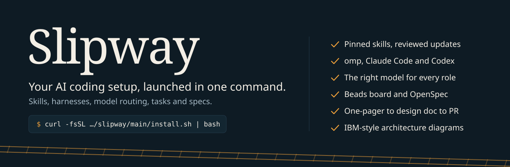
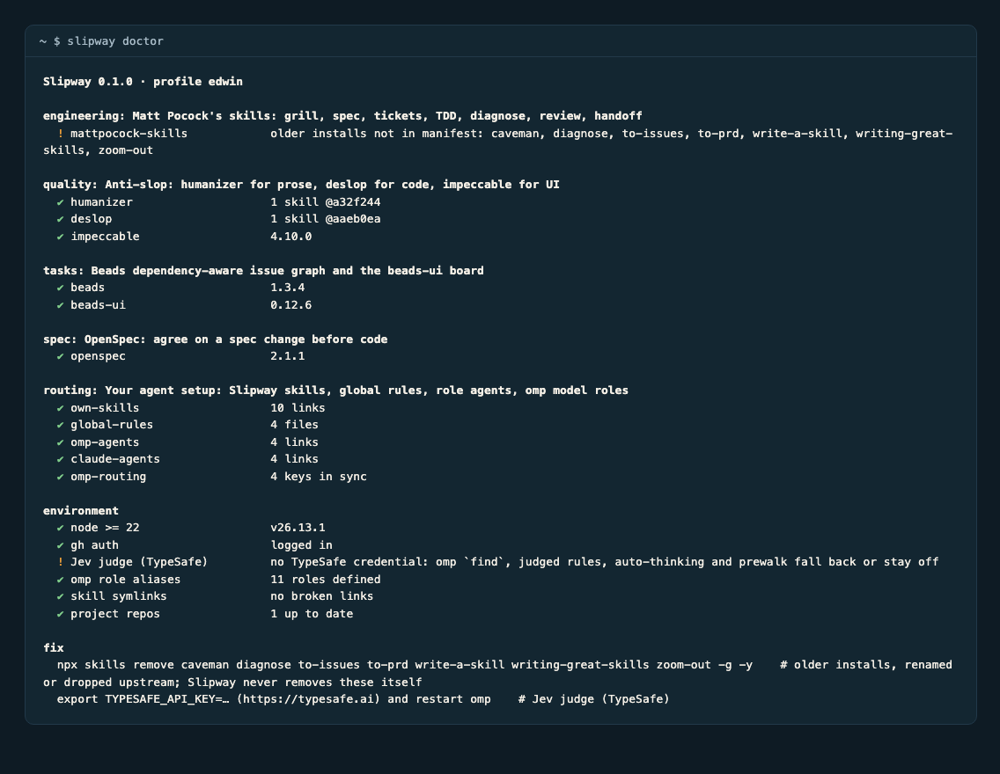

<p align="center">
  
</p>

<p align="center">
  <a href="https://github.com/edwinjosechittilappilly/slipway/actions/workflows/ci.yml"></a>
  
  <a href="LICENSE"></a>
</p>

# Slipway

Slipway is dotfiles for AI coding agents. One command installs omp, Claude Code and Codex, gives them the same 35
skills and the same working rules, routes each kind of job to the model you picked for it, and sets up a task board and
a spec tool. After that, a weekly pull request tells you exactly which skills changed upstream before anything on your
machine moves.

```bash
# Preview first: changes nothing
curl -fsSL https://raw.githubusercontent.com/edwinjosechittilappilly/slipway/main/install.sh | bash -s -- --dry-run

# Install (add --profile claude-code or --profile codex if omp is not your agent)
curl -fsSL https://raw.githubusercontent.com/edwinjosechittilappilly/slipway/main/install.sh | bash
```

While the repo is private, swap `curl -fsSL <url>` for
`gh api repos/edwinjosechittilappilly/slipway/contents/install.sh -H "Accept: application/vnd.github.raw"`.

## A day with Slipway

The `slipway` command runs in your terminal. Your work happens inside the agent, where the skills already are.

```bash
slipway doctor        # once in a while: what is installed, outdated, or needs a login
cd ~/code/my-app
slipway init          # once per repo: task board, specs, agent rules
omp                   # then just talk to it
slipway ui            # in a second terminal: the task board in your browser
```

Ask "what's next?" and the `ship-flow` skill reads the repo and picks the stage: question the idea, write a one-pager,
design it with diagrams, agree a spec, split it into tickets, build test-first, review on a different model, open the
PR. This is a real answer from omp in a fresh repo:

<p align="center"></p>

Run `slipway ui` and the same feature shows up on the Beads board, with each ticket blocked, ready, in progress or
done:

<p align="center"></p>

And `slipway doctor` on the same machine, with the fix it suggests for skills that upstream renamed:

<p align="center"></p>

## What it installs

Matt Pocock's engineering skills, anti-slop checks for prose (humanizer), code (deslop) and UI (impeccable), Beads with
its board, OpenSpec, draw.io, and five skills of its own: `ship-flow`, `exec-one-pager`, `design-doc`,
`arch-diagram` (IBM, C4 or your brand style) and `spec-to-beads`. Extra packs add ShipShape, TypeSafe Jev, security
review, Agent Deck and Gas City. `slipway packs` lists everything.

Your config stays yours. Slipway backs it up before each run, keeps any value you changed, and `slipway uninstall`
removes what it wrote.

## Documentation

The docs site is at **<https://edwinjosechittilappilly.github.io/slipway/>**: a guide (getting started, daily use,
ship flow) and the reference (commands, configuration, skills, models and harnesses, design, decisions). To preview
changes locally:

```bash
make docs-serve       # http://127.0.0.1:8000/slipway/
```

Or read the pages on GitHub: [getting started](docs/getting-started.md), [daily use](docs/using.md),
[ship flow](docs/ship-flow.md), [commands](docs/commands.md), [configuration](docs/configuration.md),
[skills](docs/skills.md), [models and harnesses](docs/harnesses.md), [design](docs/design.md),
[decisions](docs/adr/README.md), [comparison with other tools](docs/comparison.md).

[ShipShape](https://github.com/edwinjosechittilappilly/shipshape-stack) makes a repository agent-ready; Slipway does the
same for your machine. Apache-2.0; upstream skills keep their own licences.
