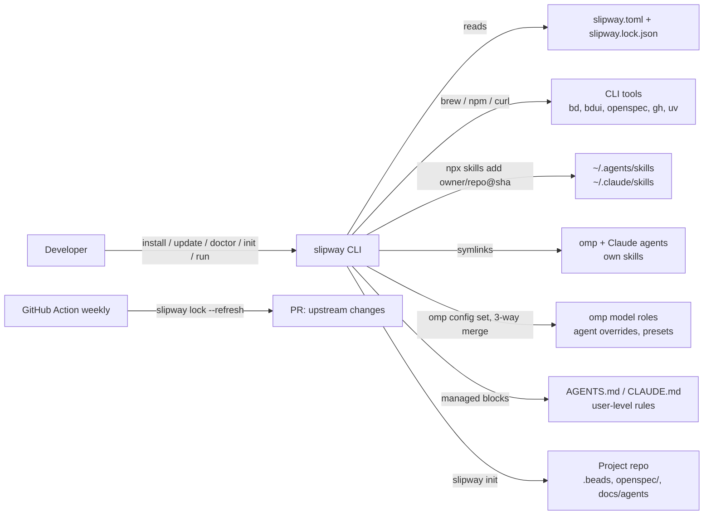
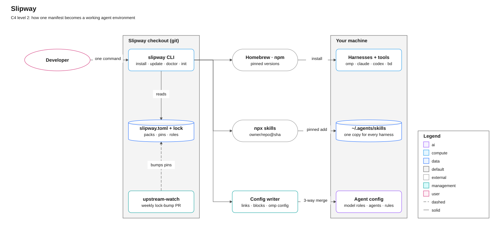
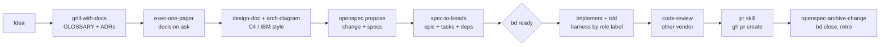

# Slipway design doc

| | |
|---|---|
| Status | Accepted, v0.1 implemented |
| Owner | Edwin Jose |
| Reviewers | `reviewer` subagent (plan review, 14 findings, all addressed in v0.1), CI |
| Executive summary | [one-pager.md](one-pager.md) |
| Decisions | [adr/](adr/README.md) |

## 1. Context and scope

An agentic development environment today is spread over a dozen places: skills in `~/.agents/skills`, Claude Code
plugins in `~/.claude/plugins`, omp model roles in `~/.omp/agent/config.yml`, custom subagents in three different
folders, CLI tools from Homebrew and npm, and per-repo files that tools like Beads and OpenSpec write. Each piece is
installed by hand, upgraded by hand (or never), and drifts. Upstream skill packs rename things (`to-prd` became
`to-spec`, `diagnose` became `diagnosing-bugs`), and the old copies keep loading.

Slipway is a git repository plus a small CLI that owns this environment as code:

- **One command** sets up a machine: `curl … | bash` (public) or `gh api …/install.sh | bash` (private, uses your
  `gh` login).
- **One manifest** (`slipway.toml`) declares every tool, skill pack, plugin, harness, model role and agent.
- **One lockfile** (`slipway.lock.json`) pins upstream skill sources to commits, so skill updates arrive as
  reviewable pull requests instead of silent changes to the prompts your agents run.
- **One per-project command** (`slipway init`) wires a repo for the delivery flow: Beads, OpenSpec, and the docs the
  engineering skills expect.

Out of scope: application templates (that is [ShipShape](https://github.com/edwinjosechittilappilly/shipshape-stack)),
secrets management, and running agents in parallel (Agent Deck or Gas City do that; Slipway installs and configures
them).

## 2. Goals and non-goals

Goals

1. A new Mac reaches a working omp + Claude Code + Codex setup with the chosen skills in one command. The only
   interactive steps are the Homebrew password and harness logins, which `install` lists at the end.
2. Re-running any command is safe: idempotent, `--dry-run` everywhere, never overwrites a file or config value the
   user changed.
3. Updates are visible: upstream skill changes land as PRs with compare links; `slipway doctor` shows drift.
4. Works across harnesses: one shared skill copy (`~/.agents/skills`) for omp, Codex and Pi, symlinked into Claude
   Code; the same delivery rules injected into each harness's user-level instructions.
5. A forker gets their own environment by editing one file.

Non-goals

- Replacing `npx skills`, Homebrew, or harness plugin managers. Slipway calls them.
- A daemon or background sync. Everything runs when you run it.
- Windows. Linux is best-effort through Homebrew on Linux.

## 3. The design

### 3.1 System context

The IBM Design Language view of the same system, generated by this repo's own `arch-diagram` skill:

### 3.2 Components

| Component | Responsibility | Lives in |
|---|---|---|
| `install.sh` | Bootstrap: Homebrew, then git, gh, Node and uv; clone or reuse the checkout; `uv tool install --editable`; run `slipway install` | repo root |
| Manifest | Packs → components (tool, skills, plugin, harness, link, block), roles, `[omp]` settings | `slipway.toml` |
| Profiles | Personal overlay: model ids, extra packs, role overrides (`profiles/edwin.toml`) | `profiles/` |
| Lock | Pinned commit per skill source; pinned npm versions; observed brew versions | `slipway.lock.json` |
| Local overlay | Machine-only profile choice, pack toggles and overrides, never committed | `~/.config/slipway/config.toml` |
| State | What Slipway last wrote (links, omp record values, skill content hashes, who installed what) | `~/.local/state/slipway/state.json` |
| CLI | `install`, `update`, `doctor`, `packs`, `init`, `roles`, `run`, `ui`, `lock`, `uninstall` | `src/slipway/` |
| Own skills | `ship-flow`, `exec-one-pager`, `design-doc`, `arch-diagram`, `spec-to-beads` | `skills/` |
| Agents | omp task agents and Claude Code subagents per role | `agents/` |
| Project templates | Beads issue-tracker docs for Matt Pocock's skills, AGENTS.md block | `templates/project/` |

### 3.3 Component kinds

Every manifest entry has a `kind`, and each kind knows how to check, install and upgrade itself. Adding a tool is a
manifest edit, not code.

| Kind | Check | Install | Upgrade |
|---|---|---|---|
| `brew` / `cask` | `command -v <bin>` or a `check` command | `brew install [--cask] <name>` | `brew upgrade <name>` (only if brew owns it) |
| `npm` | `command -v <bin>`; version vs lock | `npm install -g <pkg>@<locked>` | same; `--latest` ignores the lock |
| `script` | `command -v <bin>` | upstream installer (`curl … \| sh`) | the tool's own `upgrade` command |
| `skills` | dir + `~/.agents/.skill-lock.json` source and commit; content hash vs last install | `npx skills@<locked> add <repo>@<sha> -g -a <agents> -s <names> -y` | same with the new SHA; edited skills are skipped |
| `impeccable` | `~/.agents/skills/impeccable` + recorded version | `npx impeccable@<locked> install --providers=… --scope=global -y` | same with `--force` |
| `claude-plugin` | listed in `installed_plugins.json` | `claude plugin marketplace add` + `install` | `claude plugin update` |
| `omp-plugin` | `omp plugin list --json` | marketplace add + install, or `omp plugin install github:…` | `omp plugin upgrade` |
| `link` | symlink points into the checkout | symlink (adopts identical copies) | none needed: `git pull` |
| `block` | hash in the begin marker vs content | managed block in AGENTS.md / CLAUDE.md / GEMINI.md | same, unless you edited it |
| `omp-config` | `omp config list --scope global --json` | `omp config set <key> <json>` after the 3-way merge | same |

A missing prerequisite (for example no `claude` CLI for a Claude plugin) is a skip, not a failure. A same-named skill
from a different source is never overwritten.

### 3.4 Config ownership: the 3-way rule

Slipway writes three kinds of user config: symlinks, managed text blocks, and omp settings record entries
(`modelRoles`, `task.agentModelOverrides`, `modelPresets`). It reads only what the user's global `config.yml` sets
(not omp's defaults) and remembers the value it last wrote. On the next run:

| Live value | Last written | Manifest | Action |
|---|---|---|---|
| missing | none | X | write X |
| X | any | X | nothing (adopt X as last written) |
| X | X | Y | write Y (user never touched it) |
| Z | X or none | Y | keep Z, report drift (user changed it, or had it first) |
| missing | X | X | keep it removed, report drift (user deleted it) |
| X | X | gone | remove it (manifest dropped the key) |
| Z | X | gone | forget it; Z stays |

`--force` writes the manifest value in the drift rows. This is the hash-tracked manifest idea from the
research-agent-harness `pakage/install.py`, applied to config keys. Managed blocks carry their hash in the begin
marker (`<!-- slipway:begin rules sha256=… -->`), so the same rule works on any machine and in project repos without
local state. Symlinks record their component; when a component or its target leaves the repo, the link is removed if
it still points where Slipway left it.

### 3.5 Skills and the lock

- Upstream packs install with `npx skills add owner/repo@<sha> -g -a pi claude-code -s <names…> -y`. `pi` writes the
  real copy to `~/.agents/skills` (read by omp, Codex and Pi); `claude-code` symlinks it into `~/.claude/skills`.
- Each pack lists skills explicitly. The skills catalog ([skills.md](skills.md)) records why each one is in.
- `slipway lock --refresh` resolves each source's default-branch HEAD with `git ls-remote`, rewrites the lock, and
  prints compare URLs. The `upstream-watch` workflow runs it weekly and opens a PR.
- Own skills are symlinked from the clone, so `git pull` updates them with no reinstall.
- `doctor` flags same-source skills the manifest does not list. Those Slipway installed (and you later dropped)
  are removed by `slipway update --prune`; older installs, such as upstream-renamed `to-prd`, `to-issues`,
  `diagnose`, `caveman`, `zoom-out`, are listed with the exact `npx skills remove … -g -y` command and never deleted
  automatically.

### 3.6 Delivery flow and where each tool sits

The `ship-flow` skill encodes this map and tells the agent which skill, tool and role to use at each stage.

### 3.7 Roles and harnesses

`[roles.*]` in the manifest maps a role (explore, plan, implement, review, issues, pr, docs, design) to a harness
(omp, claude, codex, gemini, cursor-agent) and a model. Inside omp, roles are omp model roles and task agents, so
subagents route automatically. Across harnesses, `slipway run <role>` launches the mapped harness with the mapped
model, and `slipway run --bead <id>` reads the bead's `role:<name>` label and hands the bead to that harness.
`slipway roles` prints the matrix with availability.

The scale-up path keeps the same substrate: Agent Deck for parallel sessions in worktrees, then Gas City, which
consumes the same Beads database and has a built-in omp provider.

## 4. Alternatives considered

| Option | Why not (for now) |
|---|---|
| chezmoi / Nix home-manager | Good at files, not at agent semantics: no skill lock, no omp record merge, no per-project init. Slipway could live inside a chezmoi setup later. |
| rulesync / agentsync | Sync rules between harness formats; we need fewer formats, not more copies. `~/.agents/skills` plus managed blocks covers it. |
| Pure `npx skills` + a README | That is the current state. No pinning review, renamed skills linger, nothing configures omp or Beads. |
| Bash-only installer | Manifest parsing, 3-way merge and JSON state are fragile in Bash. Python stdlib run by uv needs no system Python. |
| Backlog.md / tk instead of Beads | Simpler, but no atomic claims or dependency graph for parallel agents, and no Gas City path. Kept as a documented fallback ([adr/0002](adr/0002-beads-for-agent-work.md)). |
| Repo as a Claude/omp plugin marketplace | Duplicates skills when combined with `npx skills` (Matt Pocock's README warns about this). One distribution channel. |

## 5. Cross-cutting concerns

- **Supply chain.** Skills are prompts that run with your permissions. Pins plus PR review are the control. Slipway
  never pipes a remote script to a shell except the documented upstream installers listed in the manifest.
- **Secrets.** Slipway never reads or writes credentials. `doctor` only checks presence (`gh auth status`,
  `TYPESAFE_API_KEY` set, `omp token typesafe` exit code).
- **Telemetry.** `DISABLE_TELEMETRY=1` and `DO_NOT_TRACK=1` are set for every `npx` call.
- **Failure handling.** Each component installs independently; failures are collected and reported at the end with
  the exact command to retry. Exit code 1 when anything failed.
- **Testing.** Stdlib `unittest`; tests run against a temporary `HOME` and a fake command runner. CI runs them on
  Ubuntu for pull requests and on Ubuntu and macOS for `main`, plus `slipway install --dry-run` for the base and
  each shipped profile in a clean `HOME`. A weekly job does a real install of the lightweight packs on a clean Ubuntu
  runner so upstream CLI flag changes surface within a week.

## 6. Risks

| Risk | Mitigation |
|---|---|
| Beads churn (Dolt migrations, weekly RCs) | Stable Homebrew channel only; `doctor` shows the version; Backlog.md fallback documented in ADR 0002 |
| Upstream CLI flag changes | Each kind's commands live in one module with tests; weekly real-install CI job |
| Skill bloat (too many descriptions in context) | Explicit skill lists per pack; heavy packs are opt-in |
| Model ids churn | Base manifest uses omp role aliases only; model ids live in profiles; `doctor` flags undefined aliases |
| A skill name taken by two sources | Contract test fails the build; installer refuses to overwrite a skill from another source |
