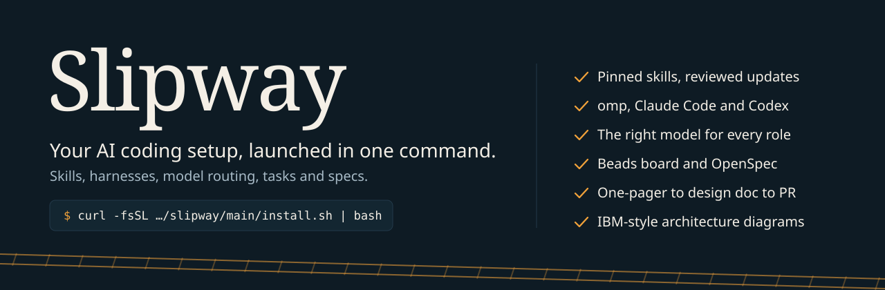
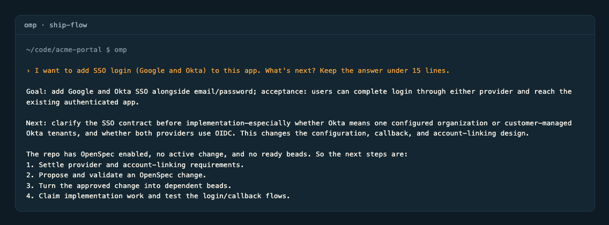

# Slipway { .visually-hidden }

Slipway is dotfiles for AI coding agents. One command installs omp, Claude Code and Codex, gives them the same skills
and working rules, routes each kind of job to the model you picked, and sets up a task board and a spec tool.

```bash
curl -fsSL https://raw.githubusercontent.com/edwinjosechittilappilly/slipway/main/install.sh | bash -s -- --dry-run
```

The preview changes nothing. Drop `--dry-run` to install.

<div class="grid cards" markdown>

- **[Getting started](getting-started.md)**

    Install, check with `slipway doctor`, set up your first repo.

- **[Daily use](using.md)**

    What runs in the terminal and what you ask inside your agent.

- **[Ship flow](ship-flow.md)**

    How the agent goes from an idea to a merged PR, and how it knows the next step.

- **[Configuration](configuration.md)**

    Profiles, packs, and switching single components off.

</div>


