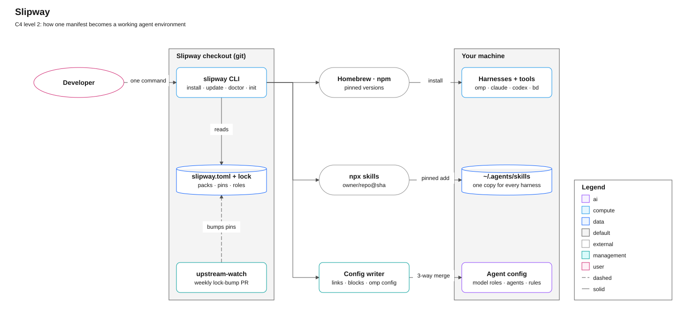

# One command for a reviewed, current agent workstation

**Ask:** approve Slipway as the single way Edwin's machines (and, once public, other developers') install and update
their agent tooling, decided by Edwin by 2026-12-01.
**In one sentence:** a git repo plus a small CLI that installs the author's 26 components (23 from 8 default packs,
3 from his profile) in one command, pins every upstream skill to a commit, and turns upstream changes into reviewable
pull requests.

## Problem

The agent setup on the author's main machine on 2026-11-20 had 24 skills in `~/.agents/skills` (22 tracked from 2
sources, 2 untracked), 3 Claude plugins managed separately, hand-edited omp model roles, and no task tracker or spec
tool. 7 of those skills were stale: upstream had renamed or removed them (`to-prd`, `to-issues`, `diagnose`,
`caveman`, `zoom-out`, `write-a-skill`, `writing-great-skills`), and all 7 still loaded into every session. Nothing
recorded which commit of a skill (a prompt that runs with full permissions) was installed, and a new machine meant
repeating the setup from memory.

## Proposal

Keep the whole environment in one repository: a manifest of packs, a lock of pinned versions, personal profiles, and
five house skills for the delivery flow (idea → one-pager → design → OpenSpec → Beads → PR). `slipway install` sets up
a machine; `slipway update` moves it to the reviewed lock; `slipway doctor` shows drift; `slipway init` wires a repo.
It does not replace Homebrew, npm or the skills CLI; it calls them. Agent fleets (Gas City) stay opt-in.

## Impact

| Metric | Before | Measured after v0.1 | By |
|---|---|---|---|
| Commands to set up a machine | estimate: ~25, from several READMEs | 1 (`install.sh`); 21 s on an already-provisioned Mac | 2026-11-20 |
| Stale skills loaded unnoticed | 7 | 0 unnoticed (`doctor` lists all 7 with the exact remove command) | 2026-11-20 |
| Skill sources pinned to a commit | 0 of 2 | 8 of 8 | 2026-11-20 |
| Harnesses sharing one rule set | 0 | 4 (omp, Claude Code, Codex, Gemini) | 2026-11-20 |

## Cost and timeline

Built in one session. Running cost: about 15 minutes a week to review the upstream-watch PR. Milestones: M1 private
use on the author's machines (now); M2 public release with a demo recording after two weeks of daily use; M3 a second
profile from another user.

## Options

| Option | Cost | Result | Why not |
|---|---|---|---|
| Do nothing | 0 now; hours per new machine | Drift continues; renamed skills linger | Problem stays |
| chezmoi or Nix for dotfiles | Learning Nix, or templating every file | Files sync, but no skill pins, omp merge or repo init | Solves a third of it |
| Superpowers or another methodology pack | 0 | One methodology, no environment management | Not an installer |
| **Slipway** | One repo to maintain | One command, reviewed updates, one flow | Chosen |

## Risks

| Risk | Likelihood | Mitigation | Owner |
|---|---|---|---|
| Beads/Dolt release churn breaks the tracker | Medium | Stable channel only; Backlog.md fallback documented (ADR 0002) | Edwin |
| Upstream CLIs change flags | Medium | Weekly real-install CI job; one module per installer kind | CI |
| A bad upstream skill reaches agents | Low | Commit pins; weekly PR lists changed `SKILL.md` files for review | Edwin |

## If approved

Remove the 7 stale skills with the command `slipway doctor` prints, add a TypeSafe key so omp's Jev judge features
turn on, and use
`ship-flow` on the next feature. Details: [design doc](design.md), [decisions](adr/README.md).
