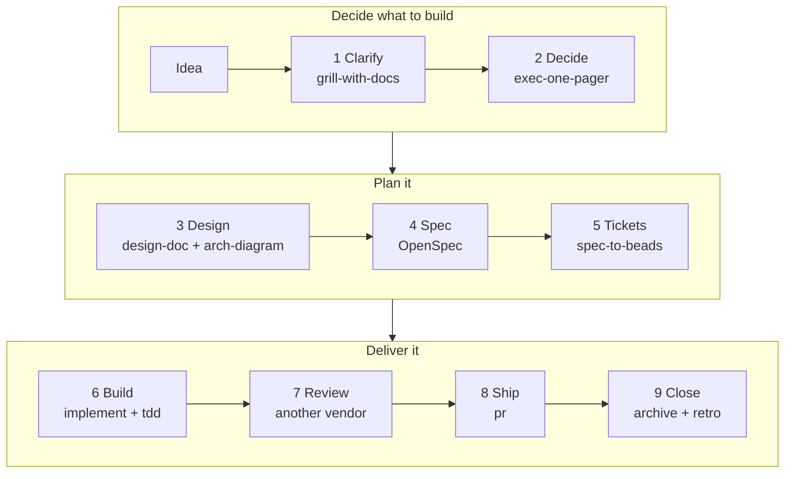

# Ship flow

`ship-flow` is the skill that answers "what's next?". It holds the delivery process, works out which stage you are in
from evidence in the repo, and tells the agent which skill runs that stage and what must be true before moving on.

Ask "what's next?" inside your agent, or call it directly: `/skill:ship-flow` (omp), `/ship-flow` (Claude Code),
`$ship-flow` (Codex).

## Size first

Small changes skip the paperwork. Gates are never skipped.

| Size | Looks like | Stages |
|---|---|---|
| Tiny | Under an hour, one area, nothing public changes | Build → review → ship |
| Small | One session, behaviour is clear | Quick `grill-me` → one bead → build → review → ship |
| Feature | Several sessions or areas, or behaviour others depend on | All nine |
| Initiative | Needs budget or buy-in, or spans features | One-pager first, then `wayfinder` to map it, then each feature |

## The stages

| # | Stage | Skill / tool | Role | Output | Done when |
|---|---|---|---|---|---|
| 1 | Clarify | `grill-with-docs` | plan | Terms in `GLOSSARY.md`, ADRs in `docs/adr/` | Goal and acceptance check fit in one line each |
| 2 | Decide | `exec-one-pager` | docs | `docs/one-pagers/<slug>.md` | The decision owner said yes |
| 3 | Design | `design-doc` + `arch-diagram` | plan | `docs/design/<slug>.md`, diagrams | Reviewed by another vendor's model |
| 4 | Spec | `openspec-propose` | plan | `openspec/changes/<slug>/` | `openspec validate` passes; you approved |
| 5 | Tickets | `spec-to-beads` | issues | Epic + beads with deps, acceptance, `role:` labels | `bd dep cycles` clean |
| 6 | Build | `bd ready` → `implement` + `tdd` | implement | Commits on a feature branch | The bead's acceptance check passes |
| 7 | Review | `code-review`, `deslop`; UI: `impeccable` | review | Findings fixed | No blockers |
| 8 | Ship | `pr`, `gh pr create` | pr | PR naming its beads and change | CI green |
| 9 | Close | `openspec-archive-change`, `bd close`, `retro` | docs | Archived change, closed epic | Specs match what shipped |

## How it finds your stage

| Evidence in the repo | Stage |
|---|---|
| Work needs buy-in and there is no `docs/one-pagers/<slug>.md` | 2 |
| One-pager approved, no `docs/design/<slug>.md` | 3 |
| Design approved, no `openspec/changes/<slug>/` | 4 |
| Change exists, no beads labelled `change:<slug>` | 5 |
| `bd ready` returns work | 6 |
| Branch ahead of `main` without a PR | 7, then 8 |
| All the epic's beads closed | 9 |

## Who does each stage

Each stage has a role. Roles map to an agent and a model ([harnesses and routing](harnesses.md)):

- **Inside omp**, subagents route themselves: `scout` explores, `planner` plans, `task` implements, `reviewer`
  reviews, `issue-writer` creates beads, `pr-author` writes the PR, `drafter` writes docs.
- **Inside Claude Code**, the subagents are `explorer`, `planner`, `cross-reviewer` and `issue-writer`.
- **Across agents**, label a bead `role:<name>` and run `slipway run --bead <id>`.
- **In parallel**, one git worktree per bead (`bd worktree create`). Claiming is atomic, so two agents never take the
  same bead.

Review always runs on a different vendor's model than the one that wrote the code.

## Rules at every stage

- Prose (one-pagers, design docs, PR bodies) goes through `humanizer`.
- Code diffs go through `deslop`; UI changes through `npx impeccable detect`.
- "Done" means the command you ran and what it printed.
- New work found mid-task becomes a bead (`--deps discovered-from:<id>`), not scope creep.

The skill itself: [`skills/ship-flow/SKILL.md`](https://github.com/edwinjosechittilappilly/slipway/blob/main/skills/ship-flow/SKILL.md).
