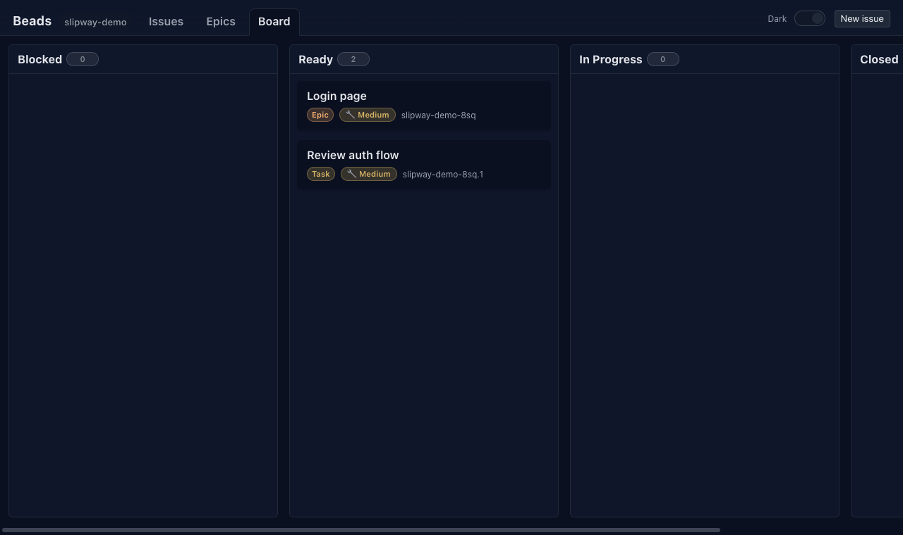

# Daily use

You use Slipway in two places:

1. **Your terminal.** The `slipway` command sets things up and keeps them current.
2. **Inside your agent** (omp, Claude Code, Codex). This is where you work. The skills Slipway installed are already
   there.

## In the terminal

| Command | When |
|---|---|
| `slipway doctor` | Something looks off, or you want to know what is outdated |
| `slipway update` | About once a week, or after merging the weekly update PR |
| `slipway init` | Once per repo, before the first agent session there |
| `slipway ui` | You want to see the task board |
| `slipway run <role> "…"` | Optional: open the agent and model mapped to a job |

## Inside your agent

| Agent | Run a skill by name | Or |
|---|---|---|
| omp | `/skill:ship-flow` | Ask in plain words |
| Claude Code | `/ship-flow` | Ask in plain words |
| Codex | `$ship-flow` | Ask in plain words |

You rarely need a skill's name. Each skill has a description, and the agent uses it when your request matches:

| You say | Skill used |
|---|---|
| "What's next?" | `ship-flow` |
| "Grill me on this idea" | `grill-with-docs` / `grill-me` |
| "Write a one-pager for X" | `exec-one-pager` |
| "Design doc for X" | `design-doc` |
| "Draw the architecture, IBM style" | `arch-diagram` |
| "Turn this spec into tickets" | `spec-to-beads` / `to-tickets` |
| "Run these beads in parallel and merge them" | `parallel-pr-delivery` |
| "Why is this test failing?" | `diagnosing-bugs` |
| "Review this branch" | `code-review`, `deslop` |
| "Write the PR" | `pr` |
| "Make this page look less generic" | `impeccable` |

The rules Slipway adds to each agent also make it run `bd prime` at the start, take work from `bd ready`, and turn
new work it discovers into beads instead of TODO comments.

## A typical session

```bash
cd ~/code/my-app
omp
```

```text
> I want to add SSO login. What's next?
```

`ship-flow` sizes the work (a feature: all nine stages) and starts with grilling: it asks questions until the goal and
acceptance check fit in one line each.

```text
> Write the one-pager for it.
```

`exec-one-pager` writes `docs/one-pagers/sso-login.md`: the ask, the problem in numbers, options with "do nothing",
cost and risks.

```text
> Approved. Design doc with a C4 container diagram.
```

`design-doc` writes `docs/design/sso-login.md`; `arch-diagram` generates `docs/diagrams/sso-login-containers.svg`
and an editable `.drawio`.

```text
> Propose it as an OpenSpec change, then make beads.
```

`openspec-propose` creates `openspec/changes/sso-login/`; `spec-to-beads` shows you the ticket graph and, once you
agree, creates an epic and child beads with dependencies and `role:` labels.

```text
> Work the next ready bead.
```

The agent claims it (`bd update --claim`), builds test-first, reviews, and writes the PR. In another terminal,
`slipway ui` shows the board change as it goes.



## Handing work to another agent

```bash
slipway run review "check the sso-login branch"     # opens the review agent and model
slipway run implement --harness codex               # same job, different vendor
slipway run --bead my-app-8sq.2                     # claims the bead and hands it over
```

See [harnesses and routing](harnesses.md).
